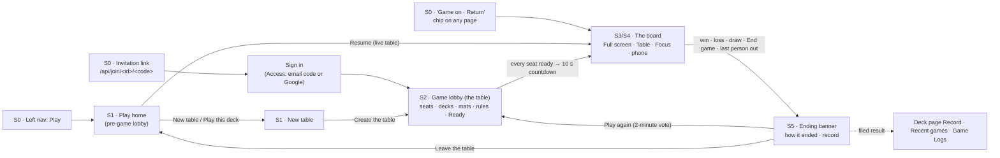

# CrankMagic Play: the game, end to end

> **One line (Rob, 2026-10-12):** *"a board game that meets a video game, that meets a social table, that meets a
> competitive league. Open and airy."*
>
> **North star, outcome 2 (Rob, 2026-10-18):** *"The game in Play is an exceptional play experience for MtG Commander
> (the game needs a name)."*

This document says, in one place, what Rob wants the CrankMagic game to be, from the moment a person clicks **Play** in
the website's left nav to the moment they see how the game ended and choose to play again. It reconciles 45 days of
Rob's prompts, playtest notes and decisions, made across Claude, Codex, Grok and Linear, into one specification. Where
his direction changed, it records the latest position and keeps the trail (Appendix B).

It has four parts:

| Part | What it answers | Who reads it first |
| --- | --- | --- |
| [Part 1: The big picture](#part-1-the-big-picture) | Why the game exists, for whom, and how we know it works | Everyone |
| [Part 2: Core concepts and intentions](#part-2-core-concepts-and-intentions) | The vocabulary, the map of the screens, the principles, and the behavior at every stage | Everyone; it anchors Parts 3 and 4 |
| [Part 3: Visual considerations](#part-3-visual-considerations) | How each screen looks, moves and sounds | Design and the Play lane |
| [Part 4: Technical specifications and requirements](#part-4-technical-specifications-and-requirements) | Architecture, contracts, and the requirement catalog with status | Engineering lanes and reviewers |

Part 2 is the anchor. Parts 3 and 4 exist to deliver what Part 2 describes, and every requirement in Part 4 traces back
to a principle or a behavior in Part 2 (Appendix A).

> **Draft status (2026-10-23).** Paused at Rob's word to save credits. Done: front matter, Part 1 (big picture),
> Part 2 sections 2.1 (glossary), 2.2 (stages and screen regions) and 2.3 (core principles). **Not yet written:**
> 2.4 (behavior at each stage), 2.5 (cross-stage models), Part 3 (visual), Part 4 (technical and the requirement
> catalog), the appendices and `PROMPT-LEDGER.md`. Links to those sections are placeholders until then. The research
> behind them (Rob's prompts from Linear, the repository and git history, and a map of the code) was gathered but
> not committed. Rob's cloud-session transcripts were not extracted (both agents for that work stopped early).


## How to use this document

### For agents (read before acting)

1. **Read order.** `AGENTS.md`, then `docs/ACTIVE.md`, then this document's Part 2, then the part your lane owns. The
   standing rules in `AGENTS.md` bind everything here.
2. **Authority.** When two sources disagree, the higher one wins (section [1.10](#110-sources-and-authority)). In short:
   `AGENTS.md` > the facts of the game (`CrankRoomView@1`) > Rob's newest dated words > this document > older plans,
   briefs, wireframes and prototypes. A newer instruction from Rob beats this document; when that happens, update this
   document in the same pull request.
3. **IDs are stable. Cite them.** Every principle, behavior, requirement and decision has an ID. Use the IDs in commit
   messages, pull requests, Linear issues and screenshots. Never renumber an ID; retire it and add a new one.
4. **Keywords.** **MUST**, **MUST NOT**, **SHOULD**, **SHOULD NOT** and **MAY** are used as in RFC 2119. A **MUST** is
   part of the launch definition unless its priority says otherwise.
5. **Status is evidence, not hope.** `Built` means merged to `main` with a suite that can fail (`AGENTS.md`, *A test that
   cannot fail is a comment*). Say which environment it is on. Anything a cloud container cannot prove (a real phone,
   hardware WebGL, a game with Rob at the table) is marked **unproven** in those words.
6. **Decisions that are Rob's** are listed as `DN-nn` in [4.13](#413-decisions-needed-from-rob). An agent records its
   recommendation and keeps working on the stated assumption. It never quietly decides one.
7. **Never decide for the player, and never fake a feature.** These two rules are the most common reason a proposal
   is refused. They are [CP-02](#cp-02-decisions-inside-the-game-belong-to-the-players) and
   [CP-05](#cp-05-the-table-is-honest-nothing-fake-nothing-before-it-works).

### ID scheme

| Prefix | Meaning | Where defined |
| --- | --- | --- |
| `O-n` | Objective | [1.3](#13-objectives) |
| `PER-n` | Persona | [1.4](#14-personas) |
| `SCN-n` | Key scenario | [1.5](#15-key-scenarios) |
| `SC-nn` | Success criterion | [1.6](#16-success-criteria) |
| `S0`–`S5`, `X` | Stage of play (S0 Entry ... S5 End), and cross-cutting | [2.2](#22-the-map-of-play-stages-and-screen-regions) |
| `PH-`, `NT-`, `GL-`, `T`, `M`, `D`, `X`, `TV-`, `FV-`, `PB-`, `EG-` | Screen regions (Play home, New table, Game lobby, board, modules, drawer settings, overlays, Table view, Focus view, phone board, end of game) | [2.2](#22-the-map-of-play-stages-and-screen-regions) |
| `CP-nn` | Core principle | [2.3](#23-core-principles) |
| `B-Sn-nn` | Behavior at a stage | [2.4](#24-the-journey-stage-by-stage) |
| `V-nn` | Visual requirement | Part 3 |
| `FR-Sn-nn` | Functional requirement | [4.9](#49-functional-requirements-catalog) |
| `NFR-nn` | Non-functional requirement | [4.10](#410-non-functional-requirements) |
| `DN-nn` | Decision needed from Rob | [4.13](#413-decisions-needed-from-rob) |
| `ROB-n` | Linear issue in Rob's workspace | Linear |
| `#n` | Pull request in `minorrob/mtg-deck-matrix` | GitHub |

### Status and priority legend

| Status | Meaning |
| --- | --- |
| **Built (prod)** | On `main` and in production (crankmagic.com, main 1fcfc3d7) |
| **Built (staging)** | On `main` and on staging (staging.crankmagic.com, main 20e30f27), not yet in production |
| **Partial** | Some of it is built. The row says what is missing |
| **Not built** | Specified, nothing on `main` |
| **Held** | Rob has held it on purpose |
| **Decision** | Waits on Rob (`DN-nn`) |

| Priority | Meaning |
| --- | --- |
| **P0** | Needed for Rob's current bar: one person against three AIs, *"just fully functional"* (2026-10-19) |
| **P1** | Needed for the launch line: invited people at the table, desktop and phone, invitation to result |
| **P2** | Wanted, after launch, or waiting on a backend that does not exist yet |
| **Held** | Not before *"we are 100% done with initial launch"* (Rob, 2026-10-18) |

### For conversion to HTML

The file is plain GitHub-flavored Markdown with YAML front matter, one H1, numbered H2/H3 headings, pipe tables, and
Mermaid diagrams in fenced `mermaid` blocks. Region maps are fenced `text` blocks so they render the same anywhere.
Every heading's text is unique, so a converter's automatic heading anchors (GitHub, Pandoc, markdown-it) are stable link
targets. IDs in bold at the start of a row or a heading are the intended deep-link targets for a future HTML build.

---

## Part 1: The big picture

### 1.1 What CrankMagic Play is

CrankMagic is Rob's Magic: The Gathering Commander app: build decks, tune them, buy cards, manage a library. **Play**
is where those decks meet other people and AI opponents at a table. It runs in the cloud: one table per game group,
CrankMagic's own rules engine (CME) as the referee, every seat shown only what that seat may see.

Play is not a separate product bolted onto the workshop. It is the edge where the loop closes:

```text
create → refine / explore → acquire → build → PLAY → results back to the deck → refine again
```

What Rob wants it to feel like, in his words:

- *"a board game that meets a video game, that meets a social table, that meets a competitive league. Open and airy."*
  (2026-10-12)
- *"We want functionality to be implied where there are parallels ... I can reach over, pick up a card I put down and
  put it back into my hand. No info needed."* (2026-10-21)
- *"any decisions that takes place within the game the players should be given that option, and we should not make the
  decision in hardcoded here for them."* (2026-09-23)
- *"We can't skip on any part."* (2026-10-21, on playing exactly as a physical table would)

The agents' compilation of his October 13 and 14 notes says the same thing at more length: *"A Commander table that
feels like a living place rather than a web page ... cards move like physical objects with a touch of magic; the
environment, the light at the table's edge and the music react to what happens in the game ... so the state of play is
felt before it is read."*

### 1.2 Mission and north star

**Mission.** Make CrankMagic's table the best place to play a Commander game with your own decks, against friends or AI,
on a desktop or a phone. It should feel like a real table, play exactly by the rules, and never take a choice away from
the person playing.

**North star.** Linear initiative I-1, set on 2026-10-18. These are the six of Rob's eleven outcomes (his words) that
bind Play:

| # | Rob's outcome | What it means for Play |
| --- | --- | --- |
| 1 | *"Play any deck of cards that is legal in MtG Commander in the Play screen."* | Any legal list seats. If a card cannot play yet, the lobby names it and says why |
| 2 | *"The game in Play is an exceptional play experience for MtG Commander (the game needs a name)."* | This document. The name is open ([DN-01](#413-decisions-needed-from-rob)) |
| 7 | *"Customize how CrankMagic tailors to me: deck and play preferences, aesthetics, the complexity of information shown."* | Play preferences, appearance, and an information complexity dial, all following the account |
| 8 | *"See the usefulness of AI in action: deck play strategies and SWOT, AI coaching, deck upgrade identification, card indexing resolution."* | The AI Coach at the table, honest AI opponents, cards learned when a deck is saved |
| 10 | *"A joyful experience end to end: deck creation → tuning → playing → acquiring → managing."* | No dead ends from invitation to result. Results feed back into the deck |
| 11 | *"Later, after the initial launch is 100% done: build decks and play Oathbreaker and Standard."* | **Held.** Commander only. Keep a `format` field open; build nothing else |

### 1.3 Objectives

| ID | Objective | Traces to |
| --- | --- | --- |
| **O-1** | **An exceptional Commander game.** The table reads as a table with people at it. An attack feels like an event, and the end feels like a story | Outcome 2 |
| **O-2** | **Every Commander-legal deck plays.** Rob's live decks play every card. Any pasted legal list seats, or the lobby names each card it cannot play and why | Outcome 1 |
| **O-3** | **Fully functional for one person against three AIs, now.** Rob's acceptance bar of 2026-10-19: *"not the refinements, just fully functional"* | Rob, 2026-10-19 |
| **O-4** | **Friends at the table without dead ends.** From invitation email to seat, deck, game, result and play again, on any window or phone, with an empty library | Outcomes 9 and 10, launch line |
| **O-5** | **The table follows the person.** Their stops, confirmations, layout, camera, sizes, sound and look travel with them, and so does how much the screen explains | Outcome 7 |
| **O-6** | **AI that helps and never cheats.** Opponents at honest difficulty labels, and a Coach that suggests in one sentence and never acts. Neither sees anything its seat may not see | Outcome 8 |
| **O-7** | **Results close the loop.** Every finished game is recorded where the person can find it, and under the deck they brought | The loop; outcome 10 |
| **O-8** | **Trustworthy by construction.** Exactly the rules, nothing hidden leaked, nothing faked, and nobody left waiting five seconds | Standing rules |

### 1.4 Personas

Rob's persona rule (brief v1, 2026-10-12): *"Design every screen so each of these four gets what they want without a mode
switch ... They differ in how much of the interface they show, not in which product they use."* So the personas below
are people. The four **playing styles** are ways any of them may want the table on a given night. The information
complexity dial (outcome 7) serves the styles. There are no modes.

#### People

| ID | Persona | Who | What they need from Play | What fails them |
| --- | --- | --- | --- | --- |
| **PER-1** | **Rob, the owner and host** (also "Trey": the MTGO research, the wireframes and his seat name use it) | Builds the decks, owns the library, invites the people, hosts the table. Today he plays alone against three AIs on staging (*"1 human v 3 AIs ... just fully functional"*, 2026-10-19). He gives feedback by playing and transcribing the game, not by filling in test scripts | His real decks playing every card exactly; flow at a table of AIs (no stop for nothing); control (End turn always asked, his choices always his); one-press play again; atmosphere; screenshots with object IDs for feedback | Being asked to click for nothing; a decision taken for him; a game that stalls on an answer he cannot give; *"I could see other player's hands"*; layouts that drift from his wireframes |
| **PER-2** | **The invited friend** (the newcomer) | Someone Rob invites by email, often with an empty library and no reason to try twice; on whatever window or phone they have (Luke, 2026-10-14/15; *"their screen wasn't maximized"*, 2026-10-13) | To land in their seat from the email; to pick one of Rob's shared decks with no setup; one obvious button; help without shame; a clear refusal that says what to do | Developer words (*"no validated deck"*); dead ends; buttons out of reach; a turn that ends without them |
| **PER-3** | **The one who stepped away** | Any player who takes a call, tends a child or drops their connection mid-game | Their seat kept warm; everyone else sees the clock; a board they can read in ten seconds when they return | Losing the game to a dropped connection at a table of AIs; returning to a board that does not say what changed |

#### Playing styles (one product, no modes)

| Style | Rob's words for what they want (brief v1, 2026-10-12) | Served by |
| --- | --- | --- |
| **Competitive** | *"Information: the stack and its resolution order, incoming attacks by type, open mana at every seat, what is castable now, odds, history that answers why, vitals at a glance, fast keys"* | Stack pile and list (M01), Table Vitals (M02), Counter-Intel (M06), keys, the *expert* end of the dial |
| **Casual** | *"Simplicity and support: one obvious button, the next step named, help without shame, no surprises, the Coach a tap away"* | The one button (T01f/T22), `why` on dark cards, glossary on hover, the Coach (M07), the *plain* end of the dial |
| **Social** | *"Playing with people: invites that work, seeing who is here, chat and emotes, a shared moment at game end, rematch in one tap"* | Invitations, Play again, held-up plays (T24), table talk (later) |
| **Competitive-social** | *"Standing: records, win rates, a leaderboard among friends, a ladder of decks"* | Filed results, deck Record, Game Logs, Standing (later) |

#### Participants who are not people

| Participant | Role | Rule |
| --- | --- | --- |
| **AI opponents** (Easy, Normal, Claude) | Fill seats so a game can happen with any number of people | They see only their own seat's view; difficulty changes effort, *"never information"*; they never make the table wait |
| **The AI Coach** | Answers the person's questions at the table | Suggests in one to three sentences, aiming for one; never acts; sees only the person's hand, deck list (not its order) and the public board |
| **Agent playtesters** (Grok Bot workers, journey suites) | Play whole games through the real UI to prove readiness | Each agent is its own seat and identity; findings carry the game's record |

### 1.5 Key scenarios

| ID | Scenario | Persona | Stages | Today |
| --- | --- | --- | --- | --- |
| **SCN-1** | **Rob against three AIs.** Play → New table with three AI seats → choose each AI's deck → Ready → Start → a full game with his own deck → *"You lost"* or *"You won"* → Play again | PER-1 | S0–S5 | **Works on staging.** The Oct 20–22 builds removed all eight rough edges found on Oct 19. *Unproven:* a full game with Rob at the table on the final build |
| **SCN-2** | **Game night.** Rob hosts; two friends join from emailed links; one AI fills the fourth seat; everyone readies; the table starts itself; they play; they play again | PER-1, PER-2 | S0–S5 | **Partial.** Link invitations and multi-person games work. Seat emails, the self-starting countdown and table talk are not built |
| **SCN-3** | **A friend's first two minutes.** Email → sign in with a code → land in the seat → choose a shared deck → Ready | PER-2 | S0, S2 | **Partial.** Invitation and sign-in are proven on staging. *Unproven:* a recipient choosing a shared deck in a lobby (ROB-30) |
| **SCN-4** | **Back to my game.** Leave the board for Decks mid-game, then come back to the same seat and the same pending question | Any | S0, S3 | **Built.** The rail's *Game on* chip, Play reopening the live table, reconnect to the same revision |
| **SCN-5** | **Play again.** After the end, one press keeps the seats, decks, rules and mats and starts the next match | Any | S5 → S2 | **Built (prod).** Two-minute vote, AI seats vote yes, the countdown starts at once |
| **SCN-6** | **Play the AI now.** From Play, two taps to a game against an AI with your last deck | PER-2, casual | S1 → S3 | **Not built** |
| **SCN-7** | **The lounge.** Open Play and see who is around, open tables, your standing and the lounge chat; join a game | Social, league | S1 | **Not built.** Waits on backends. Nothing fake ships meanwhile |

### 1.6 Success criteria

Each criterion is measurable. `Source` is where Rob, or a document he approved, set it.

| ID | Criterion | Measure | Source | Status |
| --- | --- | --- | --- | --- |
| **SC-01** | Rob can play a whole game alone against three AIs with every feature functional | A full 1-vs-3 game with Rob at the table on the current staging build, no blocker filed | Rob, 2026-10-19 | Suites pass (`tests/uat/solo-vs-ai.mjs`, three Chromium games to the end). **Unproven with Rob at the table** |
| **SC-02** | Four humans play a full game from invitation to result, on desktop and phone | Launch line, proven by the journeys and a live playtest Rob attends | `LAUNCH-CHECKLIST.md` (draft, ROB-137) | Not yet |
| **SC-03** | Nobody waits five seconds | Longest wait for the game to come back to a person < 5 s, over the network | Rob: *"we don't leave users hanging for 5 seconds"* (2026-09-21) | Proven on staging (*"Longest wait was about 3 seconds"*, 2026-10-10) |
| **SC-04** | No hidden information ever reaches a seat that may not see it | 0 leaks across every frame of every journey and harness game | Standing rule | Holding (for example 585 checks over 598 frames in three solo games) |
| **SC-05** | Every game is deterministic and replayable | Replays from seed and tape match the original's hash | Engine plan | Holding (1,400 of 1,400 games, 2026-10-11) |
| **SC-06** | A first-time player gets from Play to a game against the AI in two taps | Tap count from Play home to the first decision | Brief v2 (2026-10-12) | Not built (SCN-6) |
| **SC-07** | A first-time player reaches a first game within ten minutes of the invitation, with no dead end | Timed journey on a throttled phone profile | ROB-135 | Not built |
| **SC-08** | A host sets a table for three friends, with its rules, in under thirty seconds, and has the invite link in hand without looking for it | Timed task | Brief v2 | Not built (the New table form exists; the link is one dialog away) |
| **SC-09** | A competitive player answers "who can respond, with what, and what resolves first" without opening anything | Task test at 1280×720 | Brief v1 | Partial (the stack pile and the stack's numbered list exist; a central prompt is not built) |
| **SC-10** | A player who stepped away for two turns reads the board in ten seconds | Task test | Brief v2 | Partial (*Turns went by* exists; *what changed* marks do not) |
| **SC-11** | The board paints in under a second on the sample and stays smooth at 250 permanents | Paint time; frame rate at 250 permanents | Brief v1 | Unmeasured (ROB-67, ROB-136) |
| **SC-12** | Local feedback within 100 ms; 60 fps on desktop and at least 30 fps on the reference phone | Instrumented measurement | ROB-67 | Unmeasured |
| **SC-13** | A person is never asked a question with no real choice in it | Questions a game where the only answer is forced: 0 (empty steps, no-blocker declarations, unanswerable stack items) | Rob's playtests of 2026-10-09 and 2026-10-19 | Holding for those three (`passEmpty`, `blocksNone`, `passStack`) |
| **SC-14** | A choice the rules give a player is always asked | Engine audit list ROB-190 is empty | `AGENTS.md`; ROB-190 | Partial (a known list remains, paused at Rob's word on 2026-10-21) |
| **SC-15** | Rob's live decks play every card | Per-card regression coverage of D1–D7 | ROB-94 | Partial (22 live-deck cards still refused on main, 2026-10-22) |
| **SC-16** | Every refusal names the problem and the fix | Review of every refusal string | `AGENTS.md` | Holding where built |
| **SC-17** | WCAG 2.1 AA on the lobby and the board | `tests/a11y-board.mjs` | Standing practice | Holding (about 300 checks) |

### 1.7 Scope

| Tier | In it | Why |
| --- | --- | --- |
| **Launch: built, finish and prove** | Cloud tables of two to four seats; any mix of people and AI (Easy, Normal, Claude); invitations by link; shared decks for empty libraries; the lobby with mats and host rules; the board in Full screen, Table and Focus views and on the phone; priority, stack, combat, Yield turn, Draw card, take-back land; the AI Coach; the ending banner; Play again; record download; results filed under the deck | O-1 to O-4, O-7 |
| **Launch: still to build** | Play home as Rob described it on 2026-10-12, first half (Resume, New table, Join, Rematch, Recent games, Game Logs); the countdown that starts itself; email seat invitations; Human/AI seat setup; payment by tapping sources with Confirm cast and Auto-pay; one clear central priority prompt; host-synced appearance; match music; the game's name; the 3D renderer on the live board; Commander legality and per-card verdicts in the lobby | Launch line and Rob's open asks |
| **Later: waits on a backend** | Lounge and table chat, then voice; Open games and access states; Standing and the friends leaderboard; spectators; deals between the chairs; the story of the game; d20 for first seat; avatars for every seat | Rob asked for them. CP-05 forbids faking them before the backend exists |
| **Held by Rob** | Oathbreaker and Standard (1v1, 60 cards); Planechase; wider art mats (Rob makes them) | Rob, 2026-10-18 and 2026-10-22 |
| **Out, permanently** | Anything that decides for a player; fake activity; non-US language, currency or formats; size steps (S/M/L) | Standing rules |

### 1.8 The journey at a glance



### 1.9 Where it stands today

Production (crankmagic.com) has run cloud Play since 2026-10-12 and serves main 1fcfc3d7 (2026-10-21). Staging serves
main 20e30f27 (2026-10-22). Staging adds Rob's Full screen notes of 2026-10-21: land in any step, take back a land,
asked when aimed at, large controls over the table, opponents' plays held up for ten seconds. It also adds his lobby
notes of 2026-10-22: deck rows with colors and a description, and a Playable filter.

| Stage | What exists | Largest gaps against this document |
| --- | --- | --- |
| **S0 Entry** | Play in the left nav; the live game reopens; *Game on* chip; invitation links that survive sign-in; *Play this deck* | Play's nav highlight is lost on `#table` routes; an un-started seat does not reopen from Play |
| **S1 Pre-game lobby** | The New table form, *Your seat is waiting*, Recent games (5) | Play home as Rob described it (create, join, chat, stats, leaderboard); Play the AI now; Join by code; Game Logs |
| **S2 Game lobby** | Four quadrants with status, color fan and commander; Choose a deck (shared, library, test deck, Playable filter); Choose mat (30); invite link, QR, mailto; host rules (life, bracket); host Start and 10 s countdown; refusals with instructions | Self-starting countdown; seat emails; Human/AI seat setup; host switches for first-draw skip and skip-the-stack; deck-loading progress; per-card verdicts; host-synced appearance; Leave seat; d20 |
| **S3 Board** | Three desktop views with one header and Camera; Full screen tabletop (Pixi ground, DOM cards; tilt, zoom, cards); seven table designs (flat fallback); Volcano video; drawers and eleven modules; hand fan; stack pile; combat strip; direct blocking; held-up plays; callouts; Coach; upright phone | Central priority prompt; payment by sources; targeting arrows; 3D renderer on the live board; host-synced appearance; table chat; music pools and combat/instant audio; round labels; monarch; candidate label; what-changed marks |
| **S4 Rules** | CME referee; auto-pass where nothing matters; End turn always asked; Yield turn; Hold priority; Resolve all; Draw card; untap unspent mana; take-back land; land any step (house rule); asked when aimed at; AI at Easy/Normal/Claude | Payment drafts and Auto-pay; engine choices still made for players (ROB-190); cards defined but not played as printed (ROB-192); blocking rules (ROB-149); commander rules audit (ROB-82) |
| **S5 End** | `result.ending` banner (*"You lost. Your life reached 0..."*); Play again / Leave the table; lobby vote panel; record download (full on playtest tables); filed result under the library deck; Recent games; deck Record | Game Logs (including shared-deck games, which file nothing today); the story of the game and a scorecard; Rematch from Play home |

### 1.10 Sources and authority

**How this document was built.** From Rob's prompts in his CrankMagic cloud sessions between 2026-09-11 and 2026-10-22,
his words as quoted in the repository (`docs/ACTIVE.md`, `AGENTS.md`, the decision and handoff records, the Play lane's
instruction set, commit messages since 2026-09-08), his Linear workspace (initiative I-1 and issues ROB-10 to ROB-194),
and the code on `main` at 20e30f27. His local Claude Code, Codex and Grok sessions are present only where the
repository or Linear quotes them. The companion `PROMPT-LEDGER.md` holds his words behind each requirement.

**The authority ladder.** Higher wins. A conflict this ladder does not settle goes to Rob in one line, with a
recommendation, and work goes on with the recommendation stated as an assumption.

| Rank | Source | Governs |
| --- | --- | --- |
| 1 | `AGENTS.md` standing rules | Everything |
| 2 | The facts of the game: `docs/ui-lane/gameplay-anchor.md` (`CrankRoomView@1`) and the engine | What the game is and does. A fact beats a design; a missing fact becomes a request in `docs/ACTIVE.md` |
| 3 | Rob's newest dated words (newer beats older, his own earlier designs included) | Intent |
| 4 | **This document** | Intent, consolidated; supersedes ranks 5–8 where they differ |
| 5 | `docs/play-overhaul/` (INSTRUCTIONS, REQUIREMENTS, PLAYTEST-PLAN, PLAY-REVIEW, the `ROB-*.md` records) | Detail this document does not repeat |
| 6 | Rob's wireframes (layout) and reference videos (atmosphere and motion; *"card layout and seat positions in the videos are not authoritative"*) | Layout; motion |
| 7 | Brief v2, then brief v1 (`docs/ui-lane/astra/`) | Design reference |
| 8 | Prototypes (Replit, the Babylon lab, Magic Patterns) | Examples only. A prototype is ported, never merged as it is |
| — | The code on `main` | The truth of what is **built**, not of what is **intended** |

---

## Part 2: Core concepts and intentions

Part 2 is the anchor. It fixes the words ([2.1](#21-glossary)), the places ([2.2](#22-the-map-of-play-stages-and-screen-regions)),
the principles that decide every trade-off ([2.3](#23-core-principles)), and the behavior Rob wants at each stage of play
([2.4](#24-the-journey-stage-by-stage)). It then covers the models that run through all stages
([2.5](#25-cross-stage-models)). When a visual or technical choice is unclear, decide it by what this part says.

### 2.1 Glossary

One word for one thing. **Use the term in bold.** The *also seen as* column lists words found in Rob's prompts and
older documents for the same thing; read them as aliases, but write the bold term. The *not to be confused with*
column names the near-misses that have caused errors before.

#### Places and screens

| Term | Definition | Also seen as | Not to be confused with |
| --- | --- | --- | --- |
| **Play** | The left-nav item (`#game`) and the whole game area of the app | Play tab, Play screen | *CrankMagic Online* (the retired local Forge host) |
| **Play home** | The first screen of Play: the **pre-game lobby**. Today it is the New table form, *Your seat is waiting* and Recent games. The target is in [2.4 S1](#s1-pre-game-lobby-play-home) | pre-game lobby (Rob, 2026-10-23), pre-lobby (Rob, 2026-10-12), lounge (brief v2) | Rob's 2026-09-24 "pre-lobby", which meant a rules-only setup page. That page is retired; the rules live on the table's center panel (GL-03) |
| **New table** | The step that creates a table: your name, seats 2–4, **Create the table** | Set the table (brief v2's label), Build your Table (Forge era) | The table itself |
| **Table** | One hosted game space: up to four seats, a host, its rules, and a sequence of matches. One Durable Object per table; on screen at `#table?id=<id>` | game, pod (in rules text) | A **match** (one game at the table); a **table design** (the furniture drawn in Full screen) |
| **Game lobby** | The table's screen before and between matches: four seat quadrants, the center panel, the launch row. Table phases `selecting`, `countdown`, `starting`, `rematch` | lobby, the table room, table page | Play home |
| **Board** | The in-game screen while a match is played | play screen, game screen, game board | The **mat** (one seat's area on the board) |
| **View** | One of the board's layouts: **Full screen**, **Table**, **Focus** on desktop; the **phone board** on a phone. Switched in Camera (T10) | layout, Screen View | The browser's full-screen mode, which Full screen also requests |
| **Full screen** | The default desktop view: the tilted tabletop, the viewed seat's mat in front, the other seats across the back. It is always the tabletop; there is no 3D switch | Full view, 3D full screen | Table view |
| **Table view** | Every seat's mat as equal 16:9 tracks (2×2, or side by side for two seats) around a life dial at the true center | Grid | The **table** |
| **Focus view** | One mat as large as fits, with a seat pane showing the others | Focus | Full screen |
| **Phone board** | The layout on any screen whose shorter side is 500 px or less: upright, one Focused layout, the hand as a drawer from the bottom | mobile view, fixed Focused view | A rotated desktop board (retired) |
| **Tabletop** | Full screen's ground: a floating table slab with the mats on it and a background behind. `crankmagic-stage.js` draws it (Pixi today; Babylon planned) | stage, 3D table, ground | `crankmagic-tabletop.js`, which is the Library's card-pile view and not part of Play |
| **Background** | The scene behind the table: Volcano (Rob's video), Forest, Cloud sea | environment, scene | Table design; mat |
| **Table design** | The table as furniture: Medieval banded oak (default), Colonial inlaid mahogany, Futuristic glass, Tavern planks, Card-room felt, Carved stone dais, Volcanic obsidian | table material, table skin | Mat; background |
| **Mat** | The art under one seat's cards. 30 exist: 5 drawn by the app and 25 of Rob's artwork. Chosen per seat; everyone sees it | playmat | Table design |
| **Appearance** | Background plus table design. Today it is chosen per device (*"Appearance preview · this device"*); the target is the host's choice, shared with every seat | skins | Theme |
| **Theme** | The app-wide color theme: Moss & Iron (default), Brass & Slate, Felt & Cream, Steel & Cobalt | palette | Appearance |

#### People and seats

| Term | Definition | Also seen as | Not to be confused with |
| --- | --- | --- | --- |
| **Seat** | One of two to four places at a table. `s0`–`s3` in the engine; **Seat 1**–**Seat 4** on screen | chair, player slot | A player (a seat may be empty, an AI or a person) |
| **Host** | The person who created the table. Sits in Seat 1, invites, sets the rules, chooses AI decks, starts and cancels the countdown | lobby owner, game creator | An admin of CrankMagic |
| **Person** | A seat for a signed-in human. *"A person I will invite"* | human seat, player | A guest account (there are none: every person signs in) |
| **Invited player** | A person who joined a seat through the host's link | guest, invitee | A person on CrankMagic's invite list who has not joined a table |
| **AI seat** | A seat played by an AI at **Easy**, **Normal** or **Claude** | AI opponent, bot | The AI Coach |
| **Pilot** | The program that answers an AI seat's decisions: the house pilot (L0), the scored pilot (L1, as Easy or Normal), the agent pilot (Claude, which asks a model at close calls) | AI player | The AI Coach |
| **Level (L0–L3)** | Rob's ladder of AI decision depth: **L0** legal, **L1** probability, **L2** the deck's formulas, **L3** chained probability across the table. L1 is built; L2 and L3 are *"not right now"* (Rob, 2026-10-10) | difficulty | Bracket |
| **Viewed seat** | The seat whose mat is in front in Full screen, or focused in Focus. Changing it changes the camera and the hand shown (backs only for another seat), never what you may do | camera seat, rotate | Your seat |
| **Away** | A person whose connection dropped. Everyone sees their clock. With another person at the table they have five minutes before they are timed out; alone with AIs there is no clock | dropped | Conceded |
| **Spectator** | Someone watching who holds no seat. **Not built** | watcher | An away person |

#### Decks and cards

| Term | Definition | Also seen as | Not to be confused with |
| --- | --- | --- | --- |
| **Deck** | One hundred cards, the commander(s) included, brought to a seat: a **library deck**, a **shared deck**, or the **Basic lands test deck** (playtest tables only) | list, the hundred | A decklist pasted at the table (it is saved as a *Pasted deck* draft first) |
| **Shared deck** | One of Rob's live decks, shared so that every signed-in person can choose it at a table with no import or setup | Rob's decks, D1–D7 | A deck copied into the guest's library (nothing is copied) |
| **Playable** | A deck the table plays every card of (Rob, 2026-10-22). A Decks chip and the lobby's deck filter | playable at the table | **Boxed** (physically complete in its box). Boxed is not a Play term |
| **Known** / **to learn** | A card the engine has a definition for, or does not yet | defined / undefined | Candidate |
| **Candidate card** | A card definition made by the compiler and not yet reviewed. It plays only at labeled playtest tables | unreviewed definition | A refused card |
| **Refused card** | A card the table cannot play yet. The lobby names it and says why | unsupported | A banned card (illegal in Commander) |
| **Commander tax** | {2} more for each earlier cast of that commander from the command zone, per commander. Shown as a **tax badge** (`+2`) | tax | Mana value (never edited to show the tax) |
| **Card peek** | Hovering a card shows it large (about 400 px, never taller than the mat) | hover card | Card zoom |
| **Card zoom** | Right-click or long-press: the card in a dialog with what it can do now, or why not | inspect | Card Preview (the module, M04) |
| **Ghost** | An inspection-only outline left on the owner's mat for a permanent another player now controls (*"With <controller>"*) | control ghost | A token |

#### The turn, priority and decisions

| Term | Definition | Also seen as | Not to be confused with |
| --- | --- | --- | --- |
| **Turn ribbon** | The seven steps of a turn in the header: Untap · Upkeep · Draw · Main 1 · Combat · Main 2 · End. Done steps are struck through and the current one is lit | phase track, seven-step strip | Round |
| **Round** | One pass of turns around the table. The engine sends `round` and `turnInRound` | — | Turn number |
| **Priority** | The right to act now. The header says who holds it | — | Whose turn it is |
| **The one button** | The pass control. Its label says what passing will do: **Draw card**, **Next step**, **Pass**, **Resolve <spell>**, **End turn**, **Game over** | pass button, Pass priority (old label) | Skip to end |
| **Decision** | The room's current question to one seat (`view.decision`): an id, a title, a mode, bounds and options | prompt, choice, question | An option |
| **Option** | One legal answer to a decision. Every game action is an option the room offered | action | A preference |
| **Lit card** | A card with at least one legal option now. A **dim** card has none; its `why` says why | bright, castable | Selected |
| **why** | The room's short sentence for a card the person cannot use now (*"It costs 5 mana, and you can make 1 now"*) | reason | A rule ID |
| **You can also ▾** | The menu of priority options that are not a lit card | Actions | The Actions module (M10), which can host the same list |
| **Stack** | Spells and abilities waiting to resolve. **#1 resolves next** | — | History |
| **Resolve all** | One decision for a run of identical triggers. The person's answer is reused each time the run asks the same question | — | Skip to end |
| **Auto-pass** | The room passing for a person where nothing could matter: an empty step (`passEmpty`), a stack item they cannot answer (`passStack`), a declaration with no legal blocker (`blocksNone`). Never a real choice | skip | Yield turn (which the person asks for) |
| **Skip to end** | On your own turn: pass through the rest of it. It stops by itself when anything goes on the stack or a question comes | — | End turn |
| **Yield turn** | On another player's turn: an explicit *"pass all my priority this turn"*. It still asks every required choice and ends with that turn | yield | Concede |
| **Hold priority after I cast** | A board option: after your own cast, priority comes back to you | hold | — |
| **Skip my priority if no response possible** | A board option, on by default. Turned off, the person is asked whenever anything is on the stack (`askStack`) | — | Yield turn |
| **Stop at every step of my turn** | Settings › Play: the person is asked at every step of their own turn | step by step | — |
| **Draw card** | The normal draw waits for the person's click on the button or on their library (`drawBeat`) | draw beat | An effect that draws |
| **Take back** | Double-click a land you just played, with nothing since, and it returns to your hand (`takeBackLand`) | undo land | Undo in general (there is none) |
| **Untap** | Click a land you tapped for mana that is not yet spent, and it untaps (`untapMana`) | undo mana | Untap step |
| **House rule** | A table rule that differs from the Comprehensive Rules by choice. Examples: a land in any step of your own turn (people only); the two-player first-draw skip turned off by the host | — | A bug |
| **Refusal** | The table or the room saying no, in words that name what is wrong and then what to do | error | A warning (there are none to click past) |
| **Lean** | The mark on an option that helps an opponent or works against you (*"⚠ helps Maya"*, *"against your own"*). Information, never a block | — | A refusal |

#### Surfaces on the board

| Term | Definition | Also seen as | Not to be confused with |
| --- | --- | --- | --- |
| **Header** | The 48 px top strip of every desktop view (T01) | top bar, strip | The app's page head |
| **Action bar** | Full screen's large controls over the table: the one button, Resolve all, Skip to end or Yield turn (T22) | big buttons | The header's pill |
| **Drawer** | A side panel at the left or the right (handles T12, T13; panel T14) holding **modules** | rail, side pane, your pane | The app's left nav |
| **Module** | One panel in a drawer: On the Stack, Table Vitals, History, Card Preview, Resources, Counter-Intel, AI Coach, Recommended Actions, Chat, Actions | tab | A dialog |
| **Camera** | The menu at the canvas's top right (T10): view switch, View seats ◀ ▶, Tilt, Zoom, Cards, Background, Table design | camera panel | View |
| **Callout** | A brief, loud word over the table (*YOUR TURN*, *CAST*, *KO*, *VICTORY*). At most three at once, never over a question | overlay | Notice |
| **Held-up play** | A card another seat cast or played, held up at the left for ten seconds or until its ✕ (T24). The planned fuller form is the **reveal shelf** | pop-up, reveal | Callout |
| **Notice** | The bottom toast for confirmations and refusals, sometimes with Undo or Retry (`C.notice`) | ticker, toast | Callout |
| **History** | The public log of the game, newest first | log, Table events | Game Logs |
| **Turns went by** | The panel that says which turns passed between two of your views and what happened in them | — | History |

#### Ending and results

| Term | Definition | Also seen as | Not to be confused with |
| --- | --- | --- | --- |
| **Match** | One game at a table. Ids run `<tableId>g1`, `g2`, ... | game | Table |
| **Ending** | How a match ended (`result.ending.kind`: `won`, `draw`, `eliminated`, `conceded`, `timed-out`, `ended`) | result | The filed outcome (win, loss, draw, unfinished) |
| **Ending banner** | The panel over the board at the end (EG-01) | game-over panel, scorecard (target) | A callout |
| **End game** | Any person ends the match for everyone. The record is kept as *not finished*. Confirmed twice | End for everyone | Concede |
| **Concede** | A person leaves the game alone. It is filed as a loss | leave | Leave the table (after the end) |
| **Play again** | The table's next match: same seats, decks, rules and mats. A two-minute vote; AI seats vote yes; a No releases the seat | rematch | Rematch the last table from Play home (target) |
| **Filed result** | The game's entry in the person's library, under the library deck they brought | logged game, record line | The downloadable record |
| **Record** | The downloadable `CrankGameRecord@1`: the full replayable record at a playtest table, the person's own seat view elsewhere | game record | Filed result |
| **Recent games** | The five newest filed results, on Play home | game history | Game Logs |
| **Game Logs** | The target list of all a person's games, from the account menu on the website and in Play | — | History |

#### System

| Term | Definition |
| --- | --- |
| **CME** | CrankMagic's own rules engine. It replaced Forge (*"Ok, I'm done with Forge"*, Rob, 2026-09-24) |
| **Room** | One match being run by the engine inside the table's Durable Object |
| **`CrankRoomView@1`** | The per-seat view the room sends to the board: the seam between the engine lane and the Play lane |
| **Room key** | A behavior switch saved with a match (`passStack`, `drawBeat`, `landAnyStep`, ...). A new behavior applies to new matches only, so old games replay exactly |
| **Playtest table** | A staging table: full records, the Basic lands test deck, candidate cards |
| **AI door** | The gate for AI features (the Coach, Claude seats): open to everyone Rob admits, with spend caps |
| **Lane** | The set of files one AI workstream owns (`AGENTS.md`, *Lanes*) |
| **Staging**, **production** | staging.crankmagic.com, where Rob plays first; crankmagic.com |

#### Words not to use

| Do not write | Write instead | Why |
| --- | --- | --- |
| Online, CrankMagic Online (for cloud Play) | Play | The local Forge host is retired |
| Launch button | the countdown; Start (the host's control today) | Rob's target has no launch button |
| S / M / L, Small / Medium / Large, size steps | a slider | `AGENTS.md`, *Sizes are sliders, never steps* |
| 3D switch, 3D toggle | (nothing) | Removed: Full screen is always the tabletop |
| Panel ▸, Screen View module | Camera (for views); the drawers | Retired |
| validated, invalid, payload, or any developer word on screen | plain words (*"a deck the table can play"*) | The newcomer's first two minutes (UAT, 2026-09-22) |
| Coming Soon (on a Play build) | (nothing) | Production has served cloud Play since 2026-10-12 |
| colour, centre, grey, cancelled, and other UK spellings | color, center, gray, canceled | `AGENTS.md`, *The United States, always* |

### 2.2 The map of Play: stages and screen regions

#### Stages

Every behavior and requirement in this document is tagged with the stage it belongs to.

| Stage | Name | Starts when | Ends when | Screens |
| --- | --- | --- | --- | --- |
| **S0** | Entry | The person clicks **Play**, opens an invitation link, presses *Game on · Return*, or presses *Play this deck* | They see Play home, a game lobby or their board | Left nav, sign-in, routing |
| **S1** | Pre-game lobby | Play home is shown | They create, join, resume or rematch a table | Play home (PH), New table (NT) |
| **S2** | Game lobby | They are at a table whose match has not started, or between matches | The countdown ends and the board opens | Game lobby (GL) |
| **S3** | Play screens | The board opens | The match ends | Board: Full screen (T, M, D, X), Table view (TV), Focus view (FV), phone board (PB) |
| **S4** | Gameplay rules | (Runs inside S3) | — | What the engine and the room do, as the person experiences it |
| **S5** | Results and play again | The match ends | They play again (back to S2), leave (to S1), or go elsewhere | Ending banner (EG), the lobby's Play again panel, Recent games, Game Logs |
| **X** | Cross-cutting | — | — | Applies to every stage: accessibility, devices, US formats, privacy, performance, sound, appearance |

#### How regions are named

A region ID names a place on a screen. Requirements, screenshots and feedback cite it (Rob's instruction of
2026-10-14: *"Send screenshots after meaningful UI updates, with stable visible object IDs for feedback"*). The board's
IDs **T01–T21, M01–M04 and D01** were set on 2026-10-14 and are kept. The IDs after them are new. The ad hoc labels used
on single pull requests map as follows: `H01` → T01, `Y01` → the Yield control in T01f or T22, `C26` → T26,
`C01` → T23, `P01` → PB.

#### S1 · Play home (target layout)

```text
┌────────────────────────────────────────────────────────────────────────────────┐
│ PH-01  Play  (?)                                                                │
├────────────────────────────────────────────────────────────────────────────────┤
│ PH-02  Return banner: "You have a seat at Rob's table, turn 7 · Return"         │
├──────────────────────────────┬──────────────────────────┬──────────────────────┤
│ PH-03  Start                 │ PH-07  Open games        │ PH-08  Lounge talk   │
│   New table (primary)        │        (later)           │ PH-09  Who is here   │
│   Play the AI now            │                          │        (later)       │
│   Rematch the last table     │                          │                      │
│   Join by link or code       │                          │                      │
├──────────────────────────────┴──────────────────────────┴──────────────────────┤
│ PH-04  Recent games (cards)    PH-05  Game Logs    PH-06  Standing (later)      │
└────────────────────────────────────────────────────────────────────────────────┘
```

| ID | Region | Today |
| --- | --- | --- |
| PH-01 | Page head with help | Built |
| PH-02 | Return banner: your live game or your un-started seat | Built as *Your seat is waiting* (un-started seats); a live game redirects straight to its table |
| PH-03 | Start: New table, Play the AI now, Rematch the last table, Join by link or code | New table only |
| PH-04 | Recent games | Built (five newest filed results) |
| PH-05 | Game Logs entry | Not built |
| PH-06 | Standing: own record, then friends' leaderboard | Not built |
| PH-07 | Open games | Not built |
| PH-08 | Lounge talk | Not built |
| PH-09 | Who is here | Not built |

#### S1 · New table

```text
┌──────────────────────────────────────────────────────────────────┐
│ NT-01  You sit in Seat 1 as the host · "Your name at the table"  │
│ NT-04  "You bring <deck> to seat 1."   (from Play this deck)     │
├──────────────────────────────────────────────────────────────────┤
│ NT-02  Seat 2  [A person I will invite ▾]  [Their name      ]    │
│ NT-02  Seat 3  [Nobody ▾]                   [Name (optional)]    │
│ NT-02  Seat 4  [Nobody ▾]                   [Name (optional)]    │
├──────────────────────────────────────────────────────────────────┤
│ NT-03  Table rules (target): life · bracket · first-draw skip ·  │
│        skip the stack                                            │
│ NT-05  [ Create the table ]                                      │
└──────────────────────────────────────────────────────────────────┘
```

#### S2 · Game lobby

```text
┌──────────────────────────────────────────────────────────────────────────┐
│ GL-01  Play · "Your table. Four seats at most; it starts when everyone   │
│        is ready."                       (GL-05 Play again panel, S5)     │
├────────────────────────────────────┬─────────────────────────────────────┤
│ GL-02 seat quadrant                │ GL-02 seat quadrant                 │
│   a  Seat N · name   [status pill] │                                     │
│   b  commander card + color fan    │                                     │
│   c  "<deck> · 100 cards"          │                                     │
│   d  Choose a deck · Choose mat ·  │                                     │
│      Ready   (host: Invite ·       │                                     │
│      New link · Withdraw ·         │                                     │
│      Choose its deck)              │                                     │
├──────────────────────┬─────────────┴─────────────┬───────────────────────┤
│ GL-02 seat quadrant  │ GL-03  Table rules  [Edit]│ GL-02 seat quadrant   │
│                      │ GL-04  launch row         │                       │
│                      │  "Launches when all are   │                       │
│                      │   ready · 2 seats to go"  │                       │
│                      │  [Start] / "Starting in 7"│                       │
└──────────────────────┴───────────────────────────┴───────────────────────┘
GL-06 dialogs: a Choose a deck · b Invite to seat N · c Choose mat · d Table rules
GL-07 Table talk (later) · GL-08 refusal page ("This invitation no longer works", "Sign in to take your seat")
```

The quadrants stack into one column on a phone, and on any window where a seat's buttons would be cut off (#730).
Which corner holds which seat is an open decision ([DN-04](#413-decisions-needed-from-rob)).

#### S3 · The board, Full screen (desktop default)

```text
┌──────────────────────────────────────────────────────────────────────────────────────┐
│ T01  a vitals · name │ b turn ribbon │ c turn · priority │ d waiting │ e You can also ▾│
│                                                       f the one button pill   T20 (R) │
├────┬────────────────────────────────────────────────────────────────────────────┬────┤
│T12 │ T21 others' life               ┌──────────┬──────────┬──────────┐ T10 Camera │T13 │
│    │ (top left)                     │   T02    │   T03    │   T04    │ ▾          │    │
│    │                                │ back-row │ back-row │ back-row │            │    │
│ T14│ T24 held-up                    └──────────┴──────────┴──────────┘            │T14 │
│left│ plays (10 s)  ┌─────────────────────────────────────────────────┐ ┌────┬────┐ │right
│draw│               │ T05 front mat: the viewed seat                   │ │T06 │T28 │ │draw│
│er  │               │   T09 battlefield: creatures, then artifacts     │ │cmd │exil│ │er  │
│    │               │       and enchantments                           │ ├────┼────┤ │    │
│    │               │   T08 lands                                      │ │T07 │T27 │ │    │
│    │               └─────────────────────────────────────────────────┘ │lib │grav│ │    │
│    │  T23 decision panel      T25 callout layer       T26 combat strip  └────┴────┘ │    │
│    │  T22 action bar: [the one button] [Resolve all N] [Skip to end | Yield turn]   │    │
│    │  T15 ‹            T11 hand fan (seven at most, container-free)            › T16 │    │
└────┴────────────────────────────────────────────────────────────────────────────┴────┘
Behind everything: T17 background. The slab: T18 table design. Inside T10: T19 Cards, T29 Tilt, T30 Zoom.
```

| ID | Region | ID | Region |
| --- | --- | --- | --- |
| T01 | Header (a vitals and name, b turn ribbon, c turn and priority, d waiting text, e You can also ▾, f the one button pill) | T16 | Next hand card › |
| T02–T04 | Back-row seats, in seat order | T17 | Background |
| T05 | Front mat (the viewed seat) | T18 | Table design |
| T06 | Command zone pile (partners overlap; tax badge) | T19 | Cards slider |
| T07 | Library pile (the Draw card target) | T20 | Profile menu |
| T08 | Lands row | T21 | Others' life (top left, translucent black, opaque text) |
| T09 | Battlefield | T22 | Action bar (new) |
| T10 | Camera menu | T23 | Decision panel (new) |
| T11 | Hand fan | T24 | Held-up plays (new) |
| T12, T13 | Left and right drawer handles | T25 | Callout layer (new) |
| T14 | Drawer panel ("Your pane") | T26 | Combat strip (new) |
| T15 | Previous hand card ‹ | T27, T28 | Graveyard, Exile piles (new) |
| | | T29, T30 | Tilt, Zoom sliders (new) |

#### S3 · Modules, drawer settings and overlays

| ID | Module or overlay | Default place |
| --- | --- | --- |
| M01 | On the Stack (overlapping card pile and numbered list; #1 resolves next) | Right drawer |
| M02 | Table Vitals (life, poison, commander damage per seat) | Right drawer |
| M03 | History | Right drawer |
| M04 | Card Preview | Right drawer |
| M05 | Resources (land drop, mana in pool, lands, cards usable now) | — |
| M06 | Counter-Intel (public battlefield counts per seat) | Right drawer |
| M07 | AI Coach | — |
| M08 | Recommended Actions (shares the Coach's conversation) | — |
| M09 | Chat (an honest placeholder until table chat exists) | — |
| M10 | Actions (the current decision, docked) | — |
| D01 | Set Side Drawer Modules (Left / Right / None per module) | Settings › Play; board profile menu |
| X01 | Show hand (the hand as a fan to read; Space) | Overlay |
| X02 | Card zoom | Dialog |
| X03 | Card peek | Hover |
| X04 | Table vitals dialog | Dialog |
| X05 | Tools menu (opened as *Settings* from the profile menu) | Menu |
| X06 | Notice | Bottom toast |
| X07 | Status live region (for screen readers) | Not visible |
| X08 | Turns went by | Panel, puts itself away after 6 s |

#### S3 · Table view and Focus view

```text
Table view (four seats)                        Focus view
┌───────────────────┬───────────────────┐      ┌────────┬────────────────────────────┐
│ TV-01 seat 2      │ TV-01 seat 3      │      │ FV-01  │ FV-02 focused mat (16:9)    │
│ (16:9 track)      │ (16:9 track)      │      │ seat   │   battlefield · lands ·     │
├─────────────── TV-02 life dial ───────┤      │ pane:  │   piles                     │
├───────── TV-03 row divider ───────────┤      │ Boards │ FV-03 History band          │
│ TV-01 seat 4      │ TV-01 seat 1 (you)│      │ My     │                             │
│                   │                   │      │ board  │                             │
├───────────────────┴───────────────────┤      │ Coach  │                             │
│ TV-04 hand tray: grip · Hand cards ·  │      │◂ FV-05 │ FV-04 hand tray             │
│ Land 2/5 · Creature 0/2 · ...         │      └────────┴────────────────────────────┘
└───────────────────────────────────────┘
Both views carry the same header (T01), Camera (T10) and drawers (T12–T14) as Full screen.
```

#### S3 · The phone board (upright)

```text
┌──────────────────────────────┐
│ PB-01 rail: ✋(7) History    │
│       Coach · profile · Camera│
├──────────────────────────────┤
│ PB-02 seats: You 40 · Maya 31│
│       · Theo 40 · Ivy 22  ‹ › │
├──────────────────────────────┤
│ PB-03 pill: T7 · Main 1 ·    │
│       [Next step]            │
├──────────────────────────────┤
│ PB-04 combat picture (combat)│
│ PB-05 battlefield and lands  │
│       (scrolls in its frame) │
├──────────────────────────────┤
│ PB-06 what is asked          │
└──────────────────────────────┘
 PB-07 hand: a drawer from the bottom (✋)
 Sideways: the seats become a column at the right.
```

#### S5 · End of game

```text
┌──────────────────────────────────────────────────────────┐
│ EG-01 ending banner                                       │
│   "You lost"                                              │
│   "Your life reached 0. With only AI players left, the    │
│    game ends here."                                       │
│   [Play again] [Leave the table] [Back to the table]      │
│   [Download your record]                                  │
└──────────────────────────────────────────────────────────┘
EG-02 final callout: VICTORY or GAME OVER
EG-03 the lobby's Play again panel (GL-05): who is playing again, answers close at h:mm
EG-04 where the result lands: Recent games (PH-04), the deck page's Record
EG-05 Game Logs (target)
EG-06 the story of the game and a scorecard (later)
```

### 2.3 Core principles

Seventeen principles decide every trade-off in Play. Each gives Rob's words, what the principle means as behavior,
what it rules out, and how to check it. When two principles pull against each other, the resolution is stated (for
example, CP-04 says exactly how *flow* yields to *control*). Every behavior in [2.4](#24-the-journey-stage-by-stage)
names the principles it serves.

#### CP-01 It is a real table: imply function where there are parallels

> *"We want functionality to be implied where there are parallels ... I can reach over, pick up a card I put down and put
> it back into my hand. No info needed."* (Rob, 2026-10-21)
>
> *"can we stack basic mana cards in the Land section, then when 1 is tapped that single card in the stack tilts
> slightly"* (2026-09-24) · *"Clicking the library pile should Draw a Card"* (2026-10-09) · Rotate walks the big board
> round the table *"the way a camera would move from chair to chair"* (2026-09-29)

- **Means.** Where a physical table has an obvious gesture, the screen supports the same gesture, with no button and no
  instruction text. Pick a just-played land back up. Reach for the library to draw. Tap a land to untap it. Move a stolen
  permanent to the mat of the player who controls it. Arrange your own cards. Let a die decide who goes first. Let the
  lobby look like a table with four chairs, and the board like the same table come alive.
- **Rules out.** A button plus an explanation where a gesture exists (*"no 'You can also' button"* for the take-back).
  Arrangements no real table would have (cards of different sizes on one mat; a stolen card left on its owner's side).
- **Balance.** Every gesture keeps a keyboard and tap alternative for accessibility (NFR-10). The alternative may be
  quiet (a key on the focused card), but it is never extra on-screen instructions.
- **Check.** For each feature, ask: what would a person do at a kitchen table? If the screen asks for more than that,
  it fails this principle.

#### CP-02 Decisions inside the game belong to the players

> *"any decisions that takes place within the game the players should be given that option, and we should not make the
> decision in hardcoded here for them."* (Rob, 2026-09-23; `AGENTS.md`)

- **Means.** Every choice a rule or a card offers is put to the player who owns it. That includes trigger order,
  replacement order, which mana to spend when more than one payment is legal, whether to take a *may*, where a
  commander goes, and how a trampler's damage is split. An automatic answer is correct only where the rules leave no
  choice, and then the code cites the rule.
- **Rules out.** Resolving a choice because one branch is easier. Inferring what a player *probably* wants. A
  convenience that passes for a player unless they turned it on. Auto-pay that spends life, sacrifices, discards or
  reveals. A Coach that acts. A preference that changes a legal decision.
- **Check.** ROB-190 lists the choices the engine still makes for players. That list must reach zero (SC-14).

#### CP-03 Refuse what would break a game, with instructions

> *"when there might be human behavior that would cause issues in the game ... then we don't allow the behavior, but
> we do provide the instructions for the user."* (Rob, 2026-09-23)

- **Means.** The action is refused, and the refusal says first what is wrong and then what to do instead, naming the
  specific thing. It fires on the action, not continuously. It tells a mistake apart from normal play: a seat emptied by
  leaving, a lapsed reconnect, a declined Play again or a withdrawn invitation is *released*, never refused.
- **Worked example.** *"Sam's seat is marked as a human but nobody has been invited to it. Remove the seat assignment or
  change it to AI to start the game."*
- **Rules out.** A warning that can be clicked past. A silent correction. Developer words (*"no validated deck"*).
- **Check.** Every refusal string names the thing and the fix (SC-16). Refusals show in the table's own words, under the
  control that asked.

#### CP-04 Flow without taking control

> *"I shouldn't have to acknowledge every stage."* · *"When I play a card to the board from my hand, I don't want to
> have to click a pop-up to resolve it."* (2026-10-09)
>
> *"Passing the turn to the next player should always require player confirmation, never happen automatically."*
> (2026-10-11)
>
> Rob's acceptance bar: *"1 human v 3 AIs ... not the refinements, just fully functional"* (2026-10-19). The most-felt
> friction in that test was being stopped on every AI spell.

- **Means.** Never stop a person for nothing, and never take a real choice from them. The order of precedence is:
  1. **Required decisions** are always asked: targets, modes, *may*, replacement and trigger order, payments, discards,
     blockers, the commander's destination.
  2. **An explicit Yield turn**, which the person asked for, passes every priority for the rest of that opponent's turn.
     It still asks everything in (1).
  3. **The person's own stops and holds**: End turn on their own end step (always asked), *Stop at every step of my
     turn*, *Hold priority after I cast*, *Skip my priority if no response possible* (on by default).
  4. **Auto-pass**, used only where nothing could matter: a step with nothing to do, a stack item the person cannot
     answer (`passStack`), a block declaration with no legal blocker (`blocksNone`). Something aimed at the person or
     their things always asks them (`askAimed`).
- **Rules out.** An automatic end of turn. A pop-up to resolve your own spell. An *OK* on every notice. A Yield that
  answers *No blocks* for you. Auto-pass in any uncertain case: if the engine cannot tell whether a response exists, it
  asks.
- **Check.** SC-13 (no forced-answer questions) and SC-14 (no choice taken), together.

#### CP-05 The table is honest: nothing fake, nothing before it works

> *"No the coach shouldn't be available before it's functional (that's a standing rule for everything)."* (Rob,
> 2026-09-22)
>
> *"No stubs as 'ready for review'"* (Rob's process rules, 2026-09-17)

- **Means.** A feature appears when it works. Until then it is absent, or it is an honest, clearly marked placeholder
  (*"Game chat is not connected yet."*), never a mock that looks live. Numbers on screen are public facts, not guesses:
  a count whose inputs are not all read says so (*"n unread"*). The ending banner tells the truth about how the game
  ended. Claude availability is shown as it is, never silently swapped for Normal.
- **Rules out.** Invented open tables, fake chat, fake standings, fake spectators. A deck-loading bar that is not real
  progress. A Counter-Intel number that guesses at hidden cards.
- **Tension, resolved.** Rob asked for a lounge, chat, stats and a leaderboard (2026-10-12). They are wanted; they wait
  for their backends instead of being faked (Scope, [1.7](#17-scope)).

#### CP-06 Hidden stays hidden: fair by construction

> Rob, 2026-10-12, a defect to fix: *"I could see other player's hands."*
>
> The Coach's context: *"restricted to the content present within the player's deck and the active played board (can't
> see the opponents hands)"*, then *"within the player's hand and knowledge of their deck (not visibility into the order
> of cards in the deck)"* (2026-10-09)

- **Means.** Each seat is sent only its own view. Nothing on screen, in a tooltip, an accessible label, a log, a
  download, a screenshot or telemetry names a card that seat may not see. Viewing another seat shows its hand as backs
  and a count. AI pilots and the Coach are handed the same seat view a browser gets; *"difficulty changes search effort,
  never information"*. A playtest table's full record downloads only after the game ends.
- **Check.** SC-04: zero leaks across every frame of every journey.

#### CP-07 The state of play is felt before it is read

> The agents' compilation of Rob's 2026-10-13/14 notes: *"the environment, the light at the table's edge and the music
> react to what happens in the game (an instant on the stack, combat) so the state of play is felt before it is read."*

- **Means.** Four behavioral planes run at the table, and every feature serves at least one of them. A feature that
  serves none does not belong.

| Plane | What the person is doing | What the screen gives them | What they see | What they hear |
| --- | --- | --- | --- | --- |
| **My turn** | Sequencing lands and casts, committing attackers | A big readable mat, the turn ribbon, mana and land-drop state, lit cards | Their mat forward and lit; cards fly from library to hand and from hand to table | The game bed; the combat bed in their combat |
| **Others' turns** | Watching each card as it is played, reading it, planning against it | Held-up plays, the stack with card images, any back-row mat to inspect, Counter-Intel | The back row of three mats; a quick fade when the camera swaps seats | The game bed, never interrupted by a turn change |
| **Instant speed** | Interjecting on someone's turn while everyone waits to see what resolves | The priority prompt, the new card on top of the stack | The table's edge light shifts color; the fog tints | An instant layer over the ducked bed |
| **Combat** | Attacks, blocks and damage while the table watches one seat | Per-attacker targets, totals before Confirm, the combat strip | Edge and fog shift to the combat tint; attackers lean toward their target; arrows | The combat bed: fast in, gentle out |

- **Balance.** Atmosphere never costs legibility or speed: *"Speed is the requirement; motion is a choice"* (Rob,
  2026-09-14). Reduce motion keeps every fact and drops the decoration.

#### CP-08 Others' turns are most of the game: show what happened, and why

> *"I'm missing key notifications because of how we've laid things out."* · *"I just had a creature eliminated from my
> board. I don't know why. I don't know what dealt damage to me."* · *"I'd like to see the card attacking me and know
> the total damage and type of damage coming."* (Rob, 2026-09-21)
>
> *"I was just able to continuously draw cards and play a land after every draw."* (2026-10-01: three AI turns passed
> and nothing said so)

- **Means.** At a table of four, three turns of four belong to someone else, and what a player does in that time is the
  game. The person always sees every card another seat casts or plays (held up for ten seconds). They see every spell
  that came and went while they were passed (*CAST · Maya · Cultivate · resolved*), and which turns went by. They see
  why a permanent left, and what is attacking them, with its damage and type. History answers *why*. Back-row cards can
  be read without leaving your seat.
- **Check.** SC-10: a player who stepped away for two turns reads the board in ten seconds.

#### CP-09 The seat you are looking at gets the room; one consistent screen

> *"we want to maximize screen use in full screen and 3D full screen ... pushing all players to the far sides and back
> while keeping the active player's screen still the maximum size"* · *"I want to see all 7 phases listed out during each
> turn, which phases are complete and which is active and which are yet to come, but very concise yet readable"* (Rob,
> 2026-10-12)
>
> *"one header and Camera in every view, Tilt only in Full."* (Rob, 2026-10-18)
>
> *"the play screens are all entirely wrong from the wireframes provided ... Follow them exactly for the play
> screens."* (Rob, 2026-09-29)

- **Means.** The viewed seat's mat is as large as the layout allows. The other seats are visible but distant (one back
  row in Full screen). Every view carries the same header, Camera and drawers, so a person never relearns the screen.
  Nothing is clipped at an edge, nothing sits below the window but the hand, and no drawer resizes the table when it
  opens. Layout follows Rob's wireframes, measured, not guessed.
- **Check.** Screenshots at 1280×720, 1400×900 and 390×844 with region IDs, hit-tested at real window sizes.

#### CP-10 The player tailors the table

> *"anywhere that SML is used, instead it should be the dragging slider on the scale ... the minimum on the scale and
> the maximum, if chosen, still legible and fit properly within the design and framework ... this may ... be different
> between mobile and desktop."* (Rob, 2026-09-26)
>
> Outcome 7: *"Customize how CrankMagic tailors to me: deck and play preferences, aesthetics, the complexity of
> information shown."* (2026-10-18)

- **Means.** Every size is a continuous slider with a legible minimum and a fitting maximum (an oversized maximum is
  allowed to clip the table's edges, as Rob asked). Dividers are dragged. Drawers hold the modules the person chooses,
  in the order they choose. A preference that is a fact about the screen (a size, the camera) is remembered per device.
  A preference about the person (stops, confirmations, drawer layout, Coach settings) follows their account. How much
  the screen explains follows the information complexity dial (plain, standard, expert, ROB-125).
- **Rules out.** S / M / L, or any row of size buttons. A layout one account inherits from another.

#### CP-11 Speed is a requirement

> *"we don't leave users hanging for 5 seconds"* (Rob, 2026-09-21) · *"Longest wait was about 3 seconds. phones work."*
> (2026-10-10, after ten turns on staging)

- **Means.** No person waits five seconds for the game to come back to them, AI turns included. Local feedback appears
  within 100 ms. The game never waits on an animation. A long AI sequence shows that it is working (*"The AI players are
  taking their turns…"*).

#### CP-12 Never lose your game

> *"When a user clicks on the menu icon in the top left, then goes to Deck or other, the game should not be lost. When
> they click on Play again, it should take them back into the game if there's still a live game — humans or AI."*
> (Rob, 2026-09-30)

- **Means.** The board's connection survives the rest of the app. Play reopens a live game. Every page shows *Game on ·
  Return*. A reload returns the same revision and the same pending question. An invitation link is also the way back to
  the seat. A seat is never silently abandoned. A person who drops is held for five minutes when others are waiting, and
  everyone sees the clock. At a table with only AIs, nobody is waiting, so the game waits for them
  ([DN-05](#413-decisions-needed-from-rob)).

#### CP-13 Any legal deck plays, or the table says exactly why not

> *"I want, immediately, any 100 cards someone brings to the game to be playable, starting with my 7 decks."* (Rob,
> 2026-09-23)
>
> *"We can't skip on any part."* (2026-10-21)

- **Means.** Rob's live decks play every card. Any pasted Commander-legal list seats, or the lobby names each card it
  cannot play yet and why (a per-card verdict). Cards are learned when a deck is saved, not at the table. A card with an
  unreviewed definition plays only at a labeled playtest table. *Fix* and *ignore* are different words: a fix makes the
  card play as printed; an ignore loosens a check and stays on the list.
- **Rules out.** Silently substituting a card. Silently playing a card as vanilla. Calling a deck playable when one card
  is not.

#### CP-14 Exactly the rules, plus the house rules the table chooses

> *"Commander damage should be done in line with the game rules."* (Rob, 2026-09-23) · The two-player first-draw skip:
> *"this can be toggled off in game setup by the lobby owner"* (2026-10-12)

- **Means.** The Comprehensive Rules are the default, cited where the code makes a call. A house rule is explicit,
  scoped and visible. Today there are two: a person (not an AI) may play their land in any step of their own turn while
  holding priority with an empty stack (`landAnyStep`), and the host may turn off the two-player first-draw skip. AI
  seats play by the book.

#### CP-15 The host sets the table; each player owns their seat

> *"Host does **not** pick the guest's deck."* (Rob's game-night prompts, 2026-09-17) · *"the game creator chooses the
> background in game settings; everyone sees the same table"* (Rob, as recorded 2026-10-14)

- **Means.** The host creates the table, invites, sets the rules and the house rules before anyone is ready, chooses the
  AI seats' decks, picks the table's appearance for everyone, and decides whether the table plays again. Each person
  brings their own deck and mat, readies themselves, and makes every decision of their own seat.

#### CP-16 Rob's own look and feel

> *"keep our mats backgrounds and our theme color options"* (Rob, 2026-10-12) · *"Use HTML for the art in Full screen,
> cropped and true to the picture."* (2026-10-18) · Seven table designs, *"keep all seven designs, default
> medieval-banded"* (2026-10-17)

- **Means.** Rob's 25 artwork mats and the five drawn ones; his four themes; his card backs; his Volcano video; his
  default table. Art is cropped, never stretched or washed. Prototypes contribute ideas and code, never their own themes,
  mats or fonts.

#### CP-17 American, always

> *"I NEVER WANT ANYTHING, grammar, currency, etc. from anywhere except The US."* (Rob, 2026-09-25)

- **Means.** American English, US dollars only, and US formats for dates (*Oct 23, 2026*), times (*2:42 PM*) and numbers,
  whatever the browser's locale. Card names keep their printed spelling. `tests/feature-wiring.mjs` enforces it.
